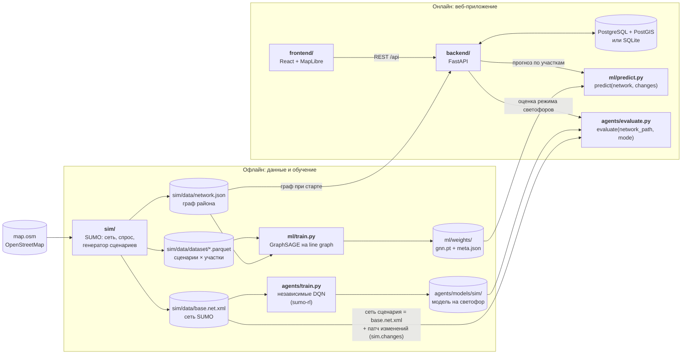
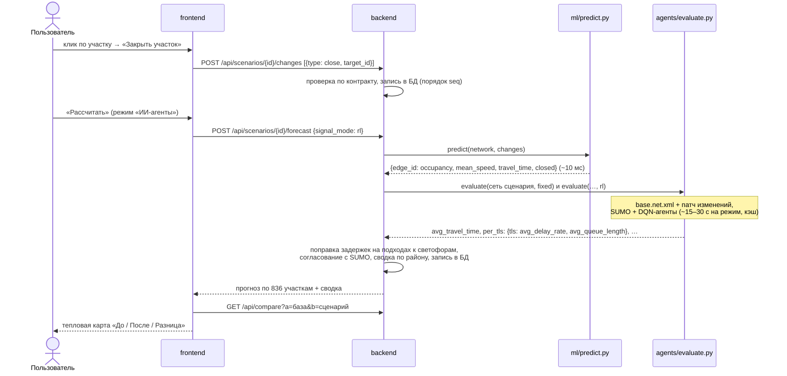

# IIgoni — интеллектуальная система моделирования и оптимизации городской транспортной сети

Прототип для дипломного проекта «Проектирование архитектуры интеллектуальной системы
моделирования и оптимизации городской транспортной сети». Пользователь меняет на карте района
дорожную сеть (закрывает улицы, меняет число полос и скорость, ставит и убирает светофоры) и
сразу видит прогноз загруженности каждого участка, сравнение «до/после» и эффект управления
светофорами RL-агентами. Район — центр Петропавловска (выгрузка OpenStreetMap `map.osm`,
≈ 3,3 × 1,9 км: 318 перекрёстков, 836 направленных участков, 31 светофор).

Главная идея архитектуры: микросимулятор SUMO слишком медленный для интерактивной работы
(десятки секунд на вариант сети), поэтому он работает **офлайн** и генерирует обучающие данные, а
в веб-приложении его заменяет графовая нейросеть, которая считает прогноз за миллисекунды.

## Содержание

1. [Архитектура](#архитектура)
2. [Контракты между частями](#контракты-между-частями)
3. [Как запустить всё с нуля](#как-запустить-всё-с-нуля)
4. [Проверка цепочки на реальной сети](#проверка-цепочки-на-реальной-сети)
5. [Что исправлено при объединении частей](#что-исправлено-при-объединении-частей)
6. [Что осталось сделать для полноценного датасета и обучения](#что-осталось-сделать-для-полноценного-датасета-и-обучения)
7. [Структура репозитория](#структура-репозитория)

## Архитектура



| Часть | Роль | Технологии | Получает | Отдаёт |
|---|---|---|---|---|
| [`sim/`](sim/README.md) | микросимуляция района, генерация обучающих данных (только офлайн) | SUMO 1.28, Python | `map.osm` | `network.json`, `base.net.xml`, спрос `trips.xml`, датасет `dataset/*.parquet`, отчёт |
| [`ml/`](ml/README.md) | прогноз загруженности каждого участка за миллисекунды | PyTorch Geometric (GraphSAGE) | граф и датасет sim/ | веса `ml/weights/`, функция `predict()` |
| [`agents/`](agents/README.md) | RL-управление светофорами (агент на перекрёсток) и сравнение с фиксированным циклом и actuated | sumo-rl, stable-baselines3 (DQN) | сеть и модель спроса sim/ | модели `agents/models/`, функция `evaluate()` |
| [`backend/`](backend/README.md) | API, хранение сети, сценариев и прогнозов, сравнение «до/после», вызов ml/ и agents/ | FastAPI, SQLAlchemy, PostGIS | `network.json`, `predict()`, `evaluate()` | REST API (`/docs`) |
| [`frontend/`](frontend/README.md) | карта района, редактор сценариев, тепловая карта, режимы светофоров | React, Vite, MapLibre GL | REST API | веб-интерфейс |

**Что происходит при нажатии «Рассчитать»:**



GNN обучена на данных SUMO с обычными светофорами, поэтому эффект ИИ-агентов backend накладывает
поправкой: на участках перед светофором время сверх свободного проезда умножается на отношение
задержек `rl / fixed` на этом перекрёстке по оценке `agents/evaluate.py` (интенсивность задержки
на подходах Σ(1 − v/v_max)). Затем поправка согласуется с SUMO: если по карте время в пути по
району сокращается сильнее, чем в прогонах SUMO для той же сети, все поправки равномерно
ослабляются — карта не обещает больше, чем показала симуляция.

## Контракты между частями

Части разрабатывались независимо по общему контракту; ниже — согласованный вариант после
объединения (подробности — в README частей).

**Граф района** `sim/data/network.json` (EPSG:4326, длины в метрах, скорости в м/с):

```jsonc
{
  "meta":  {"source": "osm", "n_nodes": 318, "n_edges": 836, "n_traffic_lights": 31, ...},
  "nodes": [{"id": "525499935", "lon": 69.14, "lat": 54.86, "type": "traffic_light",
             "tl_id": "525499935", "tl_type": "static"}],
  "edges": [{"id": "-1077110576#0", "from": "12166016825", "to": "3494782576", "length": 114.79,
             "lanes": 1, "speed": 16.67, "priority": 10, "geometry": [[69.1458606, 54.8739183], ...],
             "name": "Алтынсарин көшесі", "road_type": "highway.tertiary", "closed": false}]
}
```

Обязательные поля — `nodes[id, lon, lat, type]` и `edges[id, from, to, length, lanes, speed,
priority, geometry]`; id участков и светофоров — те же, что в сети SUMO, поэтому прогнозы GNN,
данные SUMO, модели агентов и записи БД ссылаются на одни и те же объекты.

**Изменение сети** — `{type, target_id, value}`, список применяется строго по порядку
(`close A` → `open A` ничего не меняет). Проверка — `sim/changes.py` и `backend/app/services/changes.py`:

| `type` | `target_id` | `value` |
|---|---|---|
| `lanes` | участок | число полос, целое 1…6 |
| `speed` | участок | разрешённая скорость, м/с, 1…40 |
| `close` / `open` | участок | `null` — закрыть / снять закрытие |
| `traffic_light` | узел (не тупик) | `true` или `"static"` — светофор с фиксированным циклом, `"actuated"` — адаптивный, `false` / `"off"` / `null` — убрать |

**Прогноз** `ml.predict.predict(network, changes)` →
`{edge_id: {"occupancy": 0..1, "mean_speed": м/с, "travel_time": с, "closed": bool}}` для каждого
участка; у закрытого `travel_time = null`. `predict(network, [])` в точности равен базовому
состоянию сети (прогону SUMO без изменений).

**Оценка светофоров** `agents.evaluate.evaluate(network_path, mode)`, `mode` — `fixed` | `actuated` |
`rl`. `network_path` — `sim/data/network.json` или файл сети сценария от backend/ (`meta.base_network`
+ `meta.changes`). Ответ: `avg_travel_time`, `avg_waiting_time`, `avg_queue_length`, `avg_speed`,
`p95_waiting_time`, `throughput`, `teleports`, `per_tls: {tls_id: {avg_queue_length,
avg_delay_rate}}`, `rl_fallback_tls`, `runs`, `std`. backend добавляет к ним имена `mean_*`,
которые показывает фронтенд, и переводит `per_tls` в id узлов.

**Датасет** `sim/data/dataset/`: `edges.parquet` — строка на пару (сценарий, участок): состояние
участка после изменений (`lanes`, `speed_limit`, `closed`, `changed`) и цели `occupancy`,
`mean_speed`, `travel_time` (+ доп. метрики edgeData); `scenarios.parquet` — список изменений
(`changes`, JSON) и сводка SUMO по сценарию; `nodes.parquet` — состояние узлов;
`seed_noise.parquet` — базовая сеть при 8 зёрнах SUMO (шум симуляции).

## Как запустить всё с нуля

Нужны Python 3.11, Node.js 18+ (проверено на 22), 4+ ядра CPU; GPU не нужен. Docker — по желанию.
Команды выполняются из корня репозитория.

### 1. Окружение

```bash
python3.11 -m venv .venv && source .venv/bin/activate
pip install torch --index-url https://download.pytorch.org/whl/cpu   # PyTorch без CUDA (~200 МБ)
pip install -r requirements.txt                                      # sim + ml + agents + backend
```

SUMO ставится из pip (`eclipse-sumo`), отдельная установка и `SUMO_HOME` не нужны.

### 2. Данные и модели (офлайн)

Результаты всех шагов уже лежат в репозитории (`sim/data/`, `ml/weights/`, `agents/models/`), так
что шаги можно пропустить и сразу перейти к п. 3. Повторить с нуля:

```bash
bash sim/run_all.sh 300                       # sim/: сеть, спрос, шум, датасет 300 сценариев, отчёт (~20 мин на 4 ядрах)
python -m ml.train --source sim --models sage --max-minutes 12 --final-minutes 15 \
                   --reports-dir ml/reports/sim_pilot          # ml/: GNN на датасете sim/ (~16 мин)
python -m agents.train --scenario sim --episodes 30            # agents/: DQN на 31 светофор (~32 мин, 1 ядро)
```

### 3. Веб-приложение

Бэкенд (SQLite, без Docker) — в одном терминале:

```bash
cd backend
uvicorn app.main:app --port 8000          # http://localhost:8000/docs
```

При первом старте бэкенд загружает `sim/data/network.json`, подключает `ml/predict.py` и
`agents/evaluate.py` (`GET /health` → `predictor: ml`, `evaluator: agents`) и считает прогноз
базового сценария. Режим `INTEGRATION_MODE=real` запрещает откат на заглушки,
`AGENTS_EVAL_SEEDS="101 102 103"` — три прогона SUMO на оценку режима вместо одного.

Фронтенд — во втором терминале:

```bash
cd frontend
npm ci
npm run dev                                # http://localhost:5173, /api проксируется на :8000
```

Вариант с PostgreSQL/PostGIS и nginx — Docker Compose (`WITH_ML=1` ставит в образ бэкенда
PyTorch Geometric и SUMO, иначе работают заглушки):

```bash
cd backend
WITH_ML=1 docker compose up --build        # http://localhost:8080 — приложение, :8000/docs — API
```

### 4. Проверка

```bash
python scripts/check_chain.py              # сквозная проверка цепочки на сети sim/ (~1,5 мин)
python -m pytest sim/tests ml/tests agents/tests -q
(cd backend && python -m pytest -q)
(cd frontend && npm run build)
```

## Проверка цепочки на реальной сети

Цепочка проверена на сети района из sim/ (318 перекрёстков, 836 участков, 31 светофор) с
настоящими модулями — заглушки отключены (`INTEGRATION_MODE=real`).

**1. API: `python scripts/check_chain.py`** — те же запросы, что делает frontend (префикс `/api`,
`#` в id участков кодируется как `%23`), backend в одном процессе со скриптом, временная SQLite.
Итог — 15 проверок из 15, ~80 с:

| Проверка | Результат |
|---|---|
| `GET /api/network` отдаёт граф `sim/data/network.json` | 318 узлов, 836 участков, 31 светофор |
| GNN обучена на этой сети | эталонная сеть весов совпадает: 836 из 836 участков |
| RL-агенты обучены на этой сети | 31 модель = 31 светофор |
| backend подключил `ml/predict.py` и `agents/evaluate.py` | `predictor: ml`, `evaluator: agents` |
| прогноз «до» = базовый прогон SUMO | макс. отличие занятости 0,0000; 14 мс |
| сценарий: закрыть улицу в обе стороны, +1 полоса, новый светофор | изменения приняты, `GET /api/edges/-164386376%232` работает |
| прогноз сценария (обычные светофоры) | GNN, 48 мс на запрос; заметно изменились 76 участков |
| прогноз в режиме «ИИ-агенты» | agents/ на сети сценария (base.net.xml + патч), 30 с на запрос |
| поправка по светофорам | 32 светофора, k = 0,21…0,95; эффект на карте = эффекту в SUMO (0,850 / 0,850) |
| новый светофор без модели | фиксированный цикл только у него (`rl_fallback_tls`), остальные 31 — агенты |
| `POST /api/agents/evaluate` — три режима | `mean_*` заполнены, источник — agents/, 47 с |

**2. Браузер (Playwright, frontend на Vite + backend на uvicorn)**: клик по улице Абая на карте →
«Закрыть участок» (оба направления) → «Рассчитать» → «Разница» → клик по перекрёстку →
«Добавить светофор» → «ИИ-агенты (RL)» → «Рассчитать» (31 с) → «Сравнить режимы» (14 с). В подвале
«Модель: GNN sage …, Граф: sim, 836 участков · агенты: agents», значков «заглушка» нет, ошибок в
консоли нет, на ширине телефона нет горизонтальной прокрутки; в таблице режимов — цифры SUMO и
предупреждение о новом светофоре без модели. Скриншоты — в [`frontend/README.md`](frontend/README.md).

**3. Модели на данных sim/** (подробно — в README частей):

* **GNN** (`ml/reports/sim_pilot/metrics.md`; тест — 45 сценариев, которых модель не видела):
  MAE занятости 0,0025 (без изменений — 0,0029, бустинг — 0,0026, шумовой пол SUMO — 0,0019);
  доля объяснённого эффекта изменений (R² Δ) по занятости — 0,35 (бустинг — 0,25), рядом с
  изменениями — 0,44; `predict()` — 7,7 мс на сеть района против ~13 с у прогона SUMO.
* **RL-агенты** (тест — 3 варианта спроса, которых агенты не видели, 6000 авт/ч): время в пути
  относительно фиксированного цикла — −12,9 % (actuated — −18,2 %), ожидание −38 % (actuated —
  −52 %), очередь у светофоров −78 % (actuated — −70 %). Агенты лучше фиксированного цикла, но
  пока уступают actuated — обучение пилотное (см. ниже).

## Что исправлено при объединении частей

Четыре части писались параллельно по общему контракту и проверялись каждая на своих заглушках.
При сборке цепочки на настоящей сети из sim/ нашлись несовпадения — все исправлены:

| # | Где | Несовпадение | Последствие до исправления | Исправление |
|---|---|---|---|---|
| 1 | sim → ml | ml искал датасет в `sim/data/*.parquet`, sim пишет в `sim/data/dataset/` | `python -m ml.train` молча учился на синтетике | загрузчик читает `sim/data/dataset/` (`edges` + `scenarios`), `seed_noise.parquet` — для шумового пола, `nodes.parquet` пропускается |
| 2 | ml ↔ sim | веса GNN обучены на собственной сети-заглушке ml/ (907 участков, синтетические данные) | из 836 участков сети sim/ модели были знакомы 458 (55 %): у остальных «до» — свободный поток, у знакомых — синтетика, а не SUMO | GNN переобучена на пилотном датасете SUMO: эталонная сеть весов = `sim/data/network.json` |
| 3 | sim → agents | agents строил собственный спрос между граничными улицами: на сети района ~440 авт/ч | RL-агенты учились и оценивались на почти пустой сети (очередь 0,2 авт.) | для сети sim/ — модель спроса sim/ (6000 авт/ч, те же параметры `randomTrips`, свои семена для обучения и теста) |
| 4 | agents | для сети sim/ не было обученных RL-моделей | режим «ИИ-агенты» всегда уходил в заглушку | обучены 31 DQN-агент (`agents/models/sim/`) |
| 5 | backend → agents | backend передавал сеть сценария JSON-ом без закрытых участков; agents пересобирал её `netconvert` «с нуля» | другие программы светофоров, свой ключ сети — модели не находились, `rl` падал | сеть сценария собирается из `base.net.xml` патчем `sim.changes` (как в датасете): id и фазы светофоров сохраняются, используются модели `sim` |
| 6 | backend → agents | новый светофор, поставленный пользователем, — для него нет модели | `evaluate(…, "rl")` падал, вся оценка уходила в заглушку | такой светофор работает по фиксированному циклу программы сети, остальные — агенты (`rl_fallback_tls` + предупреждение в интерфейсе) |
| 7 | agents → backend → frontend | agents отдаёт `avg_*` и `per_tls: {tls: avg_queue_length}`, backend и frontend ждали `mean_*` и `per_tls: {node: mean_waiting_time}` | поправка на режим светофоров всегда была k = 1 (ИИ-агенты не меняли карту), таблица «Светофоры» — прочерки | backend нормализует ответ (`mean_*`, `per_tls` по id узлов); agents добавил `avg_speed` и задержку на подходах `avg_delay_rate`; поправка по перекрёстку — по отношению задержек (по формуле Литтла при том же спросе) |
| 8 | backend | с настоящими цифрами агентов поправка по перекрёсткам преувеличивала эффект: в сценарии с закрытой улицей карта показывала −14 % времени в пути, SUMO — −5 % | карта обещала больше, чем показывала симуляция | поправка согласуется с SUMO (`calibrate_to_sumo`): эффект на карте не больше измеренного в SUMO |
| 9 | ml → backend | ml экспортирует `model_info()`, backend искал `MODEL_INFO` / `get_model_info()` | в таблице моделей — «GNN unversioned» без метрик | адаптер формата `model_info()` → `nn_models` (название, дата обучения, метрики, путь к весам) |
| 10 | контракт изменений | backend: полос 1…8, `traffic_light` только `true/false`, `null` = «поставить»; sim: полос 1…6, `"static"/"actuated"/"off"`, `null` = «убрать»; ml: `null` = «переключить»; светофор в тупике sim запрещает, backend — нет | 7–8 полос и светофор в тупике проходили проверку backend и ломали оценку agents; значения sim отклонялись с 422 | единый контракт по `sim/changes.py` в backend, ml и frontend (степпер полос до 6, подпись «адаптивный») |
| 11 | sim → backend | тип дороги у sim — `road_type`, backend читал `type` | пустой тип участка в БД и в карточке участка | читаются оба поля |
| 12 | backend → agents | SUMO через libsumo — одна симуляция на процесс, а FastAPI выполняет запросы в пуле потоков | два одновременных запроса с оценкой агентов запускали бы вторую симуляцию в том же процессе | вызовы `evaluate()` идут по очереди (блокировка) |
| 13 | backend → agents | 3 прогона SUMO по 70 мин модельного времени на режим | расчёт в режиме «ИИ-агенты» на сети района — 1,5–3 мин | `AGENTS_EVAL_SEEDS` (по умолчанию 1 прогон, ~15–30 с на режим), результаты кэшируются |
| 14 | Docker | репозиторий смонтирован в контейнер только для чтения, agents пишет маршруты рядом с собой | в контейнере оценка агентов падала бы и уходила в заглушку | `AGENTS_NETWORKS_DIR=/data/agents-networks` в `docker-compose.yml` |

## Что осталось сделать для полноценного датасета и обучения

Сейчас вся цепочка работает на реальной сети района, но данные и модели — **пилотные**: датасет
из 300 сценариев, GNN обучена на 210 из них, RL-агенты — 30 эпизодов. Чтобы результаты можно было
выносить в выводы диплома, нужно следующее (по порядку важности).

### Датасет (sim/)

1. **Объём.** 300 сценариев мало: GNN переобучается (ошибка на обучении падает, на валидации —
   нет), а эффект большинства изменений сравним с шумом симуляции. Цель — 3 000 сценариев (столько
   было в синтетике, на которой GNN объясняла 72 % эффекта изменений), лучше 10 000. Скорость
   сборки — ~950 сценариев/ч на 4 ядрах: 3 000 ≈ 3,2 ч, 10 000 ≈ 11 ч (на 32 ядрах ≈ 1,3 ч).

   ```bash
   python -m sim.build_dataset --n-scenarios 3000 --resume
   python -m sim.report
   ```

   `--resume` продолжает по готовым частям в `sim/data/dataset/parts/`; эта папка не хранится в
   git, поэтому на новой машине первые 300 сценариев посчитаются заново (результат тот же:
   изменения задаются зерном).
2. **Покрытие изменений.** Генератор меняет число полос только в пределах 1…4
   (`sim/config.py`: `MIN_LANES`, `MAX_LANES`), а контракт и интерфейс допускают 1…6 — 5–6 полос
   для GNN пока экстраполяция. Нужно больше сценариев с несколькими закрытиями рядом (объезды),
   новыми светофорами на крупных перекрёстках и адаптивными светофорами.
3. **Реалистичный спрос.** Сейчас спрос синтетический: `randomTrips`, 6 000 авт/ч, постоянный в
   течение часа. Нужно откалибровать его по натурным данным — счётчикам и камерам
   (`routeSampler.py` по интенсивностям на участках) или матрице корреспонденций (`od2trips`),
   добавить профиль часа пик и несколько уровней спроса (тогда уровень спроса становится
   признаком GNN), при необходимости — общественный транспорт и грузовые.
4. **Шум симуляции.** Шумовой пол (разброс базового прогона по зёрнам SUMO) по занятости —
   0,0019, а ошибка прогноза «без изменений» на тесте пилота — 0,0029. Для полного датасета:
   либо 2–3 зерна на сценарий с усреднением (×2–3 к времени сборки), либо больше сценариев;
   метод общих случайных чисел (одно зерно у базы и сценария) сохранить.
5. **Режим светофоров в данных.** Все прогоны датасета — с фиксированными программами, а эффект
   ИИ-агентов backend накладывает поправкой. Чтобы GNN предсказывала режим `rl` напрямую, нужны
   сценарии, посчитанные с обученными агентами (`agents/` уже строит сеть сценария тем же
   патчем), и признак «режим управления» у узлов.
6. **Проверка модели SUMO на реальности.** Сравнить базовый прогон с натурными скоростями и
   временем в пути (GPS-треки, данные навигационных сервисов), подобрать скорости и спрос.

### Обучение GNN (ml/)

1. Переобучить на полном датасете с абляцией архитектур (`python -m ml.train --source sim`, ~1,5 ч
   на 4 ядрах для 3 000 сценариев). На пилоте абляция не повторялась: выбор GraphSAGE с
   расширенными связями пока подтверждён только на синтетике.
2. Добавить признаки: тип светофора (сейчас светофор бинарный — перевод в адаптивный режим
   модель не видит), уровень спроса, время суток.
3. Подобрать регуляризацию и гиперпараметры под объём данных (hidden, dilations, dropout, lr) и
   сравнивать ошибку с шумовым полом SUMO; добавить оценку неопределённости прогноза (ансамбль
   или MC-dropout), чтобы показывать доверительный интервал.

### Обучение RL-агентов (agents/)

1. Обучить дольше и проверить на отложенном спросе всех уровней:
   `python -m agents.train --scenario sim --episodes 60`, затем
   `python -m agents.compare --scenario grid2x2 grid4x4 sim` (отчёт `agents/reports/`
   перезаписывается целиком, поэтому решётки указаны вместе с сетью района). Спрос — тот же, что
   после калибровки датасета (п. 3).
2. Светофор, поставленный пользователем, сейчас работает по фиксированному циклу: модели для него
   нет. Нужна общая политика для всех перекрёстков (одна сеть на признаках подходов, переносимая на
   новый светофор) или быстрое дообучение агента.
3. Координация агентов: признаки соседних перекрёстков, награда «давления» (pressure), MA2C или
   CoLight — независимые агенты проседают при перегрузке (см. `agents/README.md`).
4. Пешеходы: минимальный зелёный 5 с оптимистичен — нужны пешеходные фазы.

### Интеграция и эксплуатация

1. Оценка агентов в SUMO идёт синхронно в HTTP-запросе (15–30 с на режим, с кэшем) — вынести в
   очередь задач (Celery/RQ) со статусом прогноза.
2. Миграции БД (Alembic) вместо `create_all`, аутентификация (JWT), сборка Docker-образов в CI
   (сборка образов пока не проверялась) и PyTorch без CUDA в образе бэкенда.
3. Большие артефакты (датасет, веса, модели) — в Git LFS или DVC.

## Структура репозитория

```
├── map.osm                 выгрузка OpenStreetMap: центр Петропавловска
├── requirements.txt        все зависимости Python (sim + ml + agents + backend)
├── scripts/check_chain.py  сквозная проверка frontend-API → backend → ml/ и agents/ на сети sim/
├── sim/                    SUMO: сеть, спрос, сценарии, датасет (data/), отчёт (reports/)
├── ml/                     GNN: обучение, predict(), веса (weights/), отчёты (reports/, reports/sim_pilot/)
├── agents/                 RL-агенты светофоров: среда, DQN, evaluate(), модели (models/), отчёты
├── backend/                FastAPI + PostGIS: API, БД, интеграция, заглушки, docker-compose.yml
└── frontend/               React + MapLibre: карта, сценарии, сравнение, режимы светофоров
```
