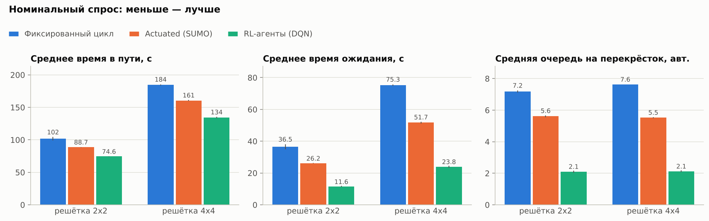
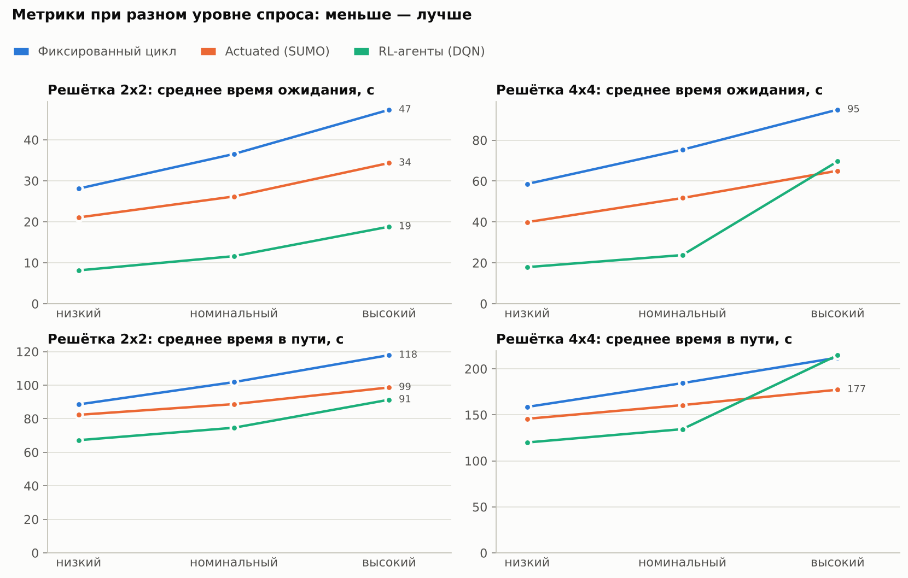
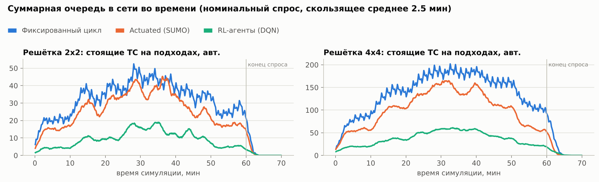
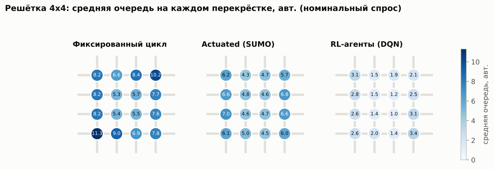
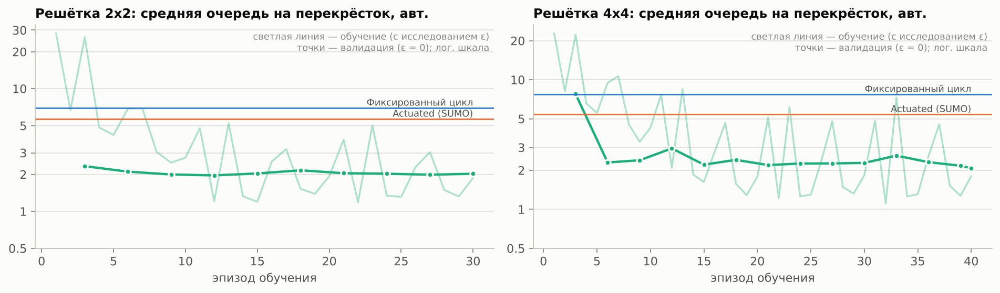

# agents/ — RL-агенты светофоров

Часть дипломного проекта «Проектирование архитектуры интеллектуальной системы
моделирования и оптимизации городской транспортной сети». Здесь каждый
перекрёсток со светофором управляется отдельным агентом обучения с подкреплением
(DQN), и результат сравнивается с обычными светофорами.

## Что сделано

1. **Среда на базе [sumo-rl](https://github.com/LucasAlegre/sumo-rl)** поверх симулятора SUMO.
   Сеть берётся из части `sim/` (`sim/data/*.net.xml`), а пока её нет — используются собственные
   синтетические решётки **2×2** (4 светофора) и **4×4** (16 светофоров).
2. **Состояние** — очереди и время ожидания по подходам + текущая фаза; **действие** — выбор
   зелёной фазы; **награда** — минус суммарная очередь.
3. **Независимые DQN-агенты** (stable-baselines3) — своя нейросеть на каждый перекрёсток,
   модели сохраняются в `agents/models/<сеть>/`.
4. **Сравнение трёх режимов** — фиксированный цикл / actuated (адаптивный по детекторам) /
   RL-агенты — по среднему времени в пути, ожиданию и длине очереди. Графики и итоговая таблица —
   в `agents/reports/`.
5. **`agents/evaluate.py`** — функция `evaluate(network_path, mode)` по контракту.
6. **Защитное правило максимального ожидания** (90 с) поверх политики — закрывает найденный при
   анализе редкий сбой агентов; доля вмешательств измеряется.
7. **Абляция** (минимальный зелёный, γ) и разбор, почему RL проседает при перегрузке сети 4×4.
8. Проверено, что весь конвейер работает и на реальной сети района из `map.osm`
   (33 светофора, см. «Интеграция с sim/»).

## Результаты

Тест — 3 варианта спроса (семена 101–103), которых агенты не видели при обучении, × 3 уровня
нагрузки. Полная таблица (все уровни, ± ст. откл., потери времени, поездки, телепортации) —
[`reports/summary.md`](reports/summary.md), сырые данные — `reports/results.csv`.

**Номинальный спрос** (в скобках — изменение относительно фиксированного цикла, меньше — лучше):

| Сеть | Режим | Время в пути, с | Ожидание, с | Очередь, авт. | 95-й проц. ожидания, с |
|---|---|---|---|---|---|
| 2×2 | фиксированный цикл | 101.8 | 36.5 | 7.18 | 97 |
| 2×2 | actuated | 88.7 (−12.9%) | 26.2 (−28.4%) | 5.61 (−21.8%) | 65 (−33%) |
| 2×2 | **RL-агенты** | **74.6 (−26.7%)** | **11.6 (−68.2%)** | **2.09 (−70.9%)** | **36 (−63%)** |
| 4×4 | фиксированный цикл | 184.4 | 75.3 | 7.63 | 176 |
| 4×4 | actuated | 160.6 (−12.9%) | 51.7 (−31.4%) | 5.52 (−27.6%) | 111 (−37%) |
| 4×4 | **RL-агенты** | **134.4 (−27.1%)** | **23.8 (−68.4%)** | **2.12 (−72.1%)** | **66 (−63%)** |











### Выводы

1. **При низком и номинальном спросе RL-агенты лучше обоих базовых режимов на обеих сетях**:
   относительно фиксированного цикла время в пути −24…−27%, ожидание −68…−71%, очередь −70…−77%;
   у actuated −7…−13%, −25…−32% и −22…−35% соответственно. Выигрыш есть и в «справедливости»:
   95-й процентиль ожидания −63…−69%, т. е. ни одно направление не «жертвуется».
2. **Чему научились агенты.** Короткий адаптивный цикл: фаза обычно держится 10–12 с (минимум,
   который разрешает среда: 3 с жёлтого + 5 с зелёного + шаг решения), защищённые левые фазы
   включаются редко (0–20% времени), левые повороты идут «с уступанием». При неполной загрузке это
   резко сокращает ожидание: машины не стоят перед пустым перекрёстком. Actuated не умеет
   пропускать фазы и тратит на цикл не меньше 4 × (5 + 3) = 32 с.
3. **Устойчивость к нагрузке.** На 2×2 RL лучше на всех уровнях, включая высокий (−22.5% времени
   в пути). На 4×4 при высоком спросе (×1.2, сеть близка к насыщению) преимущество по времени в пути
   исчезает: 214.8 ± 25.2 с против 212.2 у фиксированного цикла, actuated здесь лучший (177.3 с).
   Очереди на подходах у RL при этом самые короткие (5.1 против 7.8 у actuated): агент оптимизирует
   то, что видит. Короткие циклы теряют ~30% времени на жёлтый, пропускная способность падает, хвосты
   уходят туда, где их не видит ни один агент, — за границу сети (задержка въезда 23–55 с против
   ~0 у actuated) и в соседние перекрёстки. Это известное ограничение независимых агентов с
   локальной наградой.
4. **Проверка гиперпараметров** (абляция на 4×4, те же тестовые варианты спроса,
   `reports/ablation_grid4x4.csv`):

| Спрос | Вариант | Время в пути, с | Ожидание, с | Очередь, авт. | Телепорт. за прогон |
|---|---|---|---|---|---|
| номинальный | фиксированный цикл | 184.4 ± 1.0 | 75.3 | 7.63 | 0.0 |
| номинальный | actuated | 160.6 ± 0.7 | 51.7 | 5.52 | 0.0 |
| номинальный | **RL: базовый (min_green 5 с, γ 0.95)** | 134.4 ± 1.1 | 23.8 | 2.12 | 0.0 |
| номинальный | RL: min_green 10 с | 154.3 ± 4.1 | 37.5 | 3.05 | 0.0 |
| номинальный | RL: γ 0.99 | 133.8 ± 4.5 | 23.7 | 2.10 | 0.0 |
| высокий | фиксированный цикл | 212.2 ± 5.0 | 94.9 | 10.02 | 0.0 |
| высокий | actuated | 177.3 ± 1.6 | 65.1 | 7.76 | 0.0 |
| высокий | **RL: базовый (min_green 5 с, γ 0.95)** | 214.8 ± 25.2 | 69.6 | 5.09 | 2.0 |
| высокий | RL: min_green 10 с | 201.0 ± 5.4 | 68.5 | 5.20 | 0.0 |
| высокий | RL: γ 0.99 | 234.7 ± 35.3 | 86.0 | 6.12 | 14.0 |

   Минимальный зелёный 10 с убирает срывы при перегрузке (0 телепортаций, разброс 5.4 с вместо
   25.2 с), но ухудшает работу при номинальном спросе на 15%; γ = 0.99 ничего не даёт. Значит,
   дело не в гиперпараметрах, а в постановке (локальная награда, нет координации). Следующие шаги —
   см. «Ограничения и развитие». В основной конфигурации оставлен базовый вариант как лучший в
   рабочем диапазоне нагрузок.
5. **Обучение быстрое**: на валидации RL обгоняет actuated уже к 3–6-му эпизоду, дальше кривая
   выходит на плато (`fig_training.png`). Время обучения: 2×2 — ~7 мин, 4×4 — ~37 мин на одном ядре.
6. **Защитное правило** почти не вмешивается: 0.02–0.06% решений при низком и номинальном спросе,
   0.8% — при высоком на 4×4.

## Быстрый старт

```bash
python3.11 -m venv .venv && source .venv/bin/activate
pip install torch --index-url https://download.pytorch.org/whl/cpu   # необязательно: torch без CUDA
pip install -r agents/requirements.txt

# Все команды — из корня репозитория
python -m agents.networks                  # построить сети и маршруты (≈1 мин)
python -m agents.train                     # обучить агентов (2×2 ≈ 7 мин, 4×4 ≈ 40 мин на 1 ядре)
python -m agents.compare                   # сравнение режимов → agents/reports/ (≈10 мин)
python -m agents.evaluate --network grid4x4 --mode rl
python -m pytest agents/tests -q           # тесты (≈1 мин)
```

Обученные модели уже лежат в `agents/models/`, поэтому `compare` и `evaluate` можно запускать
сразу, без обучения. Маршруты не хранятся в git (десятки МБ) — они генерируются автоматически при
первом обращении, детерминированно по семени.

Отдельные сценарии и параметры:

```bash
python -m agents.train --scenario grid4x4 --episodes 40
python -m agents.train --scenario path/to/other.net.xml     # любая сеть SUMO
python -m agents.compare --scenario grid2x2 --levels nominal --seeds 101
python -m agents.compare --plots-only                       # перерисовать графики из results.csv

# эксперимент (абляция): параметры сохраняются в meta.json модели и применяются при оценке
python -m agents.train --scenario grid4x4 --episodes 40 --min-green 10 --out-dir agents/models/_ablation/mg10
python -m agents.evaluate --network grid4x4 --mode rl --demand high --models-dir agents/models/_ablation/mg10
```

## Интерфейс для других частей (контракт)

```python
from agents.evaluate import evaluate

m = evaluate("sim/data/network.json", mode="rl")      # mode: "fixed" | "actuated" | "rl"
m["avg_travel_time"], m["avg_waiting_time"], m["avg_queue_length"]
```

`network_path` может быть: `grid2x2` / `grid4x4` / `sim`, путём к `.net.xml` SUMO или к
`network.json` в формате контракта (если рядом нет `.net.xml`, граф конвертируется в сеть SUMO
через `netconvert`). Дополнительно: `demand="low"|"nominal"|"high"`, `seeds=[...]` (по умолчанию
3 тестовых варианта спроса; `seeds=[101]` — в 3 раза быстрее), `route_files=[...]` — свой спрос,
`models_dir=...` — другая папка моделей.

Возвращаемый словарь:

| ключ | смысл | ед. |
|---|---|---|
| `avg_travel_time` | среднее время в пути ТС (tripinfo `duration`) | с |
| `avg_waiting_time` | среднее суммарное время ожидания ТС (скорость < 0.1 м/с) | с |
| `avg_queue_length` | средняя очередь на перекрёсток: среднее по времени (шаг 5 с) и светофорам числа стоящих ТС на подходах | авт. |
| `avg_time_loss` | средние потери времени относительно свободного движения | с |
| `avg_depart_delay` | средняя задержка въезда в сеть (очередь за границей района) | с |
| `p95_waiting_time` | 95-й процентиль времени ожидания ТС — «справедливость» (не ждут ли отдельные направления слишком долго) | с |
| `throughput` | завершённых поездок | авт. |
| `teleports` | «телепортаций» застрявших ТС (признак затора) | шт. |
| `guard_rate` | доля решений RL, скорректированных защитным правилом (для fixed/actuated — 0) | доля |
| `vehicles` | ТС в спросе | авт. |
| `std` | стандартные отклонения тех же метрик по прогонам | |
| `per_tls` | `{tls_id: {"avg_queue_length": …}}` — для отображения на карте | |
| `runs` | метрики каждого прогона | |
| `network`, `mode`, `demand`, `n_runs`, `units` | описание прогона | |

Для режима `rl` нужны обученные модели этой сети (`agents/models/<сеть>/`); если их нет или сеть
изменилась так, что не совпадают светофоры/число фаз, функция выбрасывает понятное исключение
(нужно дообучение). Время работы: 2×2 — ~3 с на прогон, 4×4 — ~15–25 с (с libsumo).

Сами решётки экспортированы в формате контракта (`agents/networks/grid*/network.json`) с условной
геопривязкой к центру района из `map.osm` — их можно использовать как заглушку сети в backend/frontend.

## Структура папки

| файл | назначение |
|---|---|
| `config.py` | все параметры: пути, сети, спрос, среда, гиперпараметры DQN |
| `networks.py` | сети (решётки через `netgenerate`, сеть из `sim/`, любая `.net.xml`, `network.json`), спрос, actuated-программы, экспорт/импорт `network.json` |
| `env.py` | среда sumo-rl: наблюдение `ApproachObservation`, награда `queue_reward`, защитное правило `MaxWaitGuard`, фабрика `make_env` |
| `dqn.py` | `IndependentDQN` — набор независимых DQN (SB3), общий цикл, сохранение/загрузка |
| `train.py` | обучение с валидацией и сохранением лучших моделей |
| `evaluate.py` | `evaluate(network_path, mode)` — контракт; `run_episode` — один прогон |
| `compare.py` | сравнение трёх режимов, таблицы и графики в `reports/` |
| `tests/` | тесты (pytest) |
| `networks/grid2x2`, `networks/grid4x4` | сети SUMO, actuated-программы, `network.json` |
| `models/<сеть>/` | `tls_<id>.zip` — модели SB3, `meta.json` — описание, `training_log.csv` — лог обучения |
| `reports/` | `summary.md`, `summary.csv`, `results.csv`, `details.csv`, `ablation_grid4x4.csv`, `fig_*.png` |

## Постановка задачи

### Сеть

Решётки строятся утилитой SUMO `netgenerate`: квартал 200 м, к краям пристыкованы въездные улицы
по 200 м (каждый перекрёсток — четырёхсторонний), 2 полосы в каждом направлении + отдельная полоса
левого поворота длиной 60 м, 50 км/ч. Светофоры — на всех перекрёстках решётки. Программа SUMO по
умолчанию — 4 фазы: «С–Ю прямо/направо (налево с уступанием)», «С–Ю защищённый левый», то же для
«З–В», жёлтый 3 с, цикл 90 с (33 + 3 + 6 + 3 + 33 + 3 + 6 + 3).

### Спрос

`randomTrips.py` + `duarouter` (утилиты SUMO): поездки между граничными улицами. Интенсивность
меняется по 10-минутным интервалам как в час пик (`0.55 → 0.8 → 1.0 → 1.0 → 0.8 → 0.6` от
пиковой), главное направление запад↔восток нагружено вдвое сильнее (иначе фиксированный цикл с
равными фазами был бы почти оптимальным и сравнение было бы неинформативным). Пик — 400 авт/ч на
въезд второстепенного направления и 800 — главного; за час это ≈2 450 ТС на 2×2 и ≈7 600 ТС на
4×4. Начало и конец поездки — не ближе 1.25 квартала (иначе появляются поездки «въехал и выехал на
той же стороне», которые без разворотов превращаются в петли и искусственно забивают сеть).
Эпизод: 60 мин спроса + 10 мин разгрузки.

Варианты спроса разделены:

* **обучение** — семена 0–9, масштаб интенсивности случайный в 0.6–1.3 от номинала;
* **валидация** (выбор лучшего чекпоинта) — семя 50, номинал;
* **тест** (все результаты ниже) — семена 101–103, уровни `low` ×0.7, `nominal` ×1.0, `high` ×1.2.

Калибровка: интенсивность подобрана так, чтобы при номинальном спросе фиксированный цикл работал с
заметными очередями, а при высоком — на грани насыщения (появляется задержка въезда в сеть).

### Агент, состояние, действие, награда

Агент — один светофор. Раз в **5 с** он выбирает **номер зелёной фазы** на следующий интервал
(действие, `Discrete(число зелёных фаз)`, для решёток — 4). Если фаза меняется, sumo-rl сам
вставляет **жёлтый 3 с** и запрещает новую смену раньше **минимального зелёного 5 с** — агент не
может сделать небезопасное переключение.

**Состояние** (`env.ApproachObservation`), все признаки в [0, 1]:

```
[ one-hot текущей зелёной фазы | можно_переключить |
  очередь  [С, В, Ю, З] × {прямо/направо, налево} |
  ожидание [С, В, Ю, З] × {прямо/направо, налево} ]
```

* *подход* — полосы, которые подходят к перекрёстку с одной стороны света (сторона определяется
  по направлению полосы у стоп-линии);
* *очередь* — число стоящих ТС (v < 0.1 м/с) / ёмкость подхода (длина / 7.5 м на ТС);
* *ожидание* — среднее время простоя стоящих ТС / 120 с;
* полосы только левого поворота выделены в отдельную группу — у них своя защищённая фаза;
* размер вектора = число фаз + 17 (для решёток — 21).

**Награда**: `r = −0.1 · Σ (стоящие ТС на всех подходах перекрёстка)` — минус суммарная очередь.
Множитель 0.1 не меняет оптимальную политику, только делает Q-значения численно удобнее для сети.

**Защитное правило максимального ожидания** (`env.MaxWaitGuard`). Поверх политики агента действует
жёсткое ограничение: если какая-то машина стоит дольше **90 с**, а выбранная фаза её полосу не
обслуживает, светофор переключается на фазу, дающую этой полосе зелёный. Причина найдена при
анализе первой версии: после окончания спроса (сеть почти пустая) агент мог минутами держать
зелёный пустому направлению, пока на поперечном стояла одна машина, — выгода от переключения ради
одной машины (0.1 за шаг) тонет в ошибке аппроксимации Q-сети; через 300 с SUMO «телепортировал»
такую машину. Так устроены и реальные адаптивные системы: обучаемая логика работает внутри
ограничений безопасности. Правило действует и при обучении (в буфер попадает фактически
выполненное действие), и при оценке; доля скорректированных решений выводится как `guard_rate`
(на тесте — 0.02–0.06% решений при низком и номинальном спросе, 0.8% при высоком на 4×4).

### Алгоритм: независимые DQN

У каждого светофора своя Q-сеть, свой буфер опыта и свой ε-жадный выбор (Independent DQN). Агенты
действуют одновременно в одной симуляции; влияние соседей каждый агент «видит» только через
собственные очереди. Гиперпараметры (одинаковые для всех агентов):

| параметр | значение |
|---|---|
| сеть | MLP 2 × 64, ReLU |
| learning rate | 1e-3 (Adam) |
| γ | 0.95 (горизонт ~20 решений ≈ 100 с ≈ один цикл светофора) |
| буфер опыта | 50 000 переходов |
| батч | 64, обучение на каждом шаге |
| целевая сеть | обновление каждые 500 шагов |
| ε | 1.0 → 0.02 за первые 40 % обучения; первые 1 000 шагов — случайные действия |
| эпизодов | 30 (2×2) и 40 (4×4), 840 решений на агента в эпизоде |

Каждые 3 эпизода — валидация с ε = 0; сохраняется набор моделей с наименьшей средней очередью.

## Режимы сравнения

| режим | как реализован |
|---|---|
| `fixed` | статическая программа из сети (стандарт SUMO: цикл 90 с, равные фазы) |
| `actuated` | те же фазы, тип `actuated`: зелёный продлевается, пока индукционные петли видят поток (minDur 5 с, maxDur 50 с — значения по умолчанию `netconvert`) |
| `rl` | обученные DQN-агенты, жадная политика (ε = 0) + защитное правило 90 с |

Сравнение честное: все режимы прогоняются на **одном и том же файле маршрутов** с **одним и тем же
семенем SUMO** и с **одинаковой фазовой структурой** — отличается только логика переключения.

## Принятые решения и почему

* **sumo-rl, а не своя среда** — стандартная, проверенная обёртка SUMO для RL; жёлтые фазы и
  минимальный зелёный уже реализованы. Расширены только наблюдение и награда, плюс исправлена
  передача аргументов SUMO (в sumo-rl строка режется по пробелам и ломается на путях с пробелами).
* **Наблюдение по подходам, а не по полосам** (как в sumo-rl по умолчанию) — размер вектора не
  зависит от числа полос, поэтому модели переживают изменение числа полос в веб-приложении;
  это и есть формулировка задания («по подходам»).
* **Независимые агенты, а не одна общая сеть** — по заданию; хорошо масштабируется (каждый агент
  маленький), агенты можно переобучать по одному. Минус — нестационарность (соседи тоже учатся),
  которую на практике гасит буфер опыта и медленное убывание ε.
* **Свой цикл вместо `model.learn()`** — в SB3 `learn()` сам «крутит» среду, а здесь все агенты
  ходят одновременно в одной симуляции. Цикл повторяет `OffPolicyAlgorithm.collect_rollouts`, а
  сеть, оптимизатор, буфер, расписание ε и сохранение — готовые из SB3.
* **Усечение, а не терминальное состояние в конце эпизода** — эпизод кончается по времени,
  поэтому переход помечается `TimeLimit.truncated`, и Q-значение бутстрэпится дальше.
* **libsumo** вместо TraCI через сокет — ускорение симуляции примерно в 10 раз (2×2: 20 с → 2 с
  на эпизод). Ограничение — одна симуляция на процесс.
* **Разделение спроса на обучение/валидацию/тест** — результаты получены на вариантах спроса,
  которых агенты не видели, в том числе на нагрузке выше/ниже обучающей середины.
* **Actuated из тех же фаз** — программа генерируется из фаз сети (а не перестраивается
  `netconvert`), чтобы три режима отличались только логикой.
* **Защитное правило вместо изменения награды** — награда оставлена как в задании («минус
  очередь»), а редкий сбой политики (долгое ожидание одиночной машины) закрыт жёстким
  ограничением 90 с; это прозрачно, измеримо (`guard_rate`) и соответствует практике.
* **Телепортация через 300 с** (стандарт SUMO) — без неё один затор блокирует сеть до конца
  эпизода; число телепортаций выводится как метрика.

## Интеграция с sim/

* Как только в `sim/data/` появится `*.net.xml` (предпочтительно `network.net.xml`), команды
  `train`/`compare` без аргументов переключаются на сценарий `sim`, а `evaluate("sim/data/network.json", …)`
  использует эту сеть.
* Спрос для реальной сети: вес въезда = число полос, жилые улицы (приоритет SUMO < 7) — ×0.3,
  100 авт/ч на единицу веса в пик (`config.EXTERNAL_*`). **Эти параметры нужно откалибровать** под
  район (по данным sim/ или натурным счётам).
* Проверено на сети из `map.osm` (Петропавловск, 33 светофора после `netconvert --tls.guess-signals
  --tls.join`): среда, actuated-программы, генерация спроса, экспорт `network.json`, обучение и
  оценка работают; у перекрёстков 2–4 фазы и 19–21 признак состояния.

## Ограничения и развитие

* Фиксированный цикл — стандартный план SUMO с равными фазами, а не оптимизированный по Вебстеру;
  для более строгой базы можно добавить `tlsCycleAdaptation.py` из утилит SUMO.
* Агенты не обмениваются информацией и видят только свои подходы — отсюда просадка 4×4 при
  перегрузке (вывод 3). Следующие шаги: признаки соседей в состоянии, награда «давления»
  (`pressure`: учитывает и выходящие полосы, т. е. спилбэк), координация (MA2C, CoLight), больше
  перегруженных сценариев в обучении; как простое инженерное решение — гибрид «RL в рабочем
  диапазоне, actuated при насыщении».
* Пешеходы не моделируются, поэтому минимальный зелёный 5 с (значение sumo-rl по умолчанию)
  оптимистичен; при 10 с выигрыш RL при номинальном спросе меньше (см. абляцию).
* Модель привязана к светофору и числу его фаз: после изменения сети, меняющего фазы
  (закрытие подхода, новый светофор), агента нужно дообучить.
* Время в пути считается от момента въезда в сеть; задержка въезда (`avg_depart_delay`) выводится
  отдельно.
