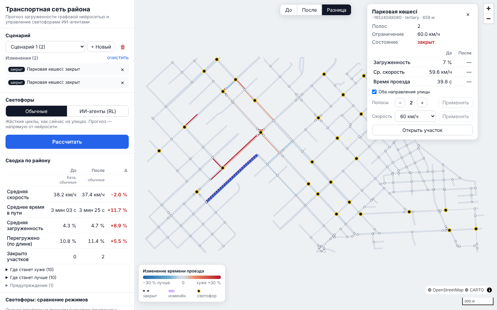
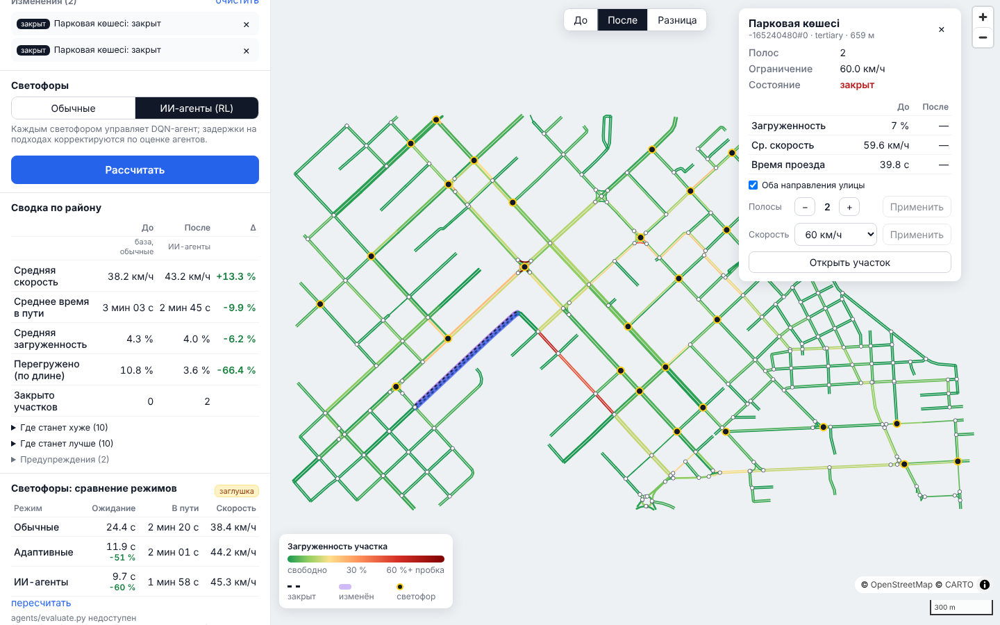

# frontend/ — веб-приложение (React + Vite + MapLibre GL)

Интерфейс прототипа: карта района, на которой пользователь меняет дорожную
сеть и сразу видит прогноз загруженности, сравнение «до/после» и эффект
ИИ-агентов на светофорах.



## Что сделано

* **Карта района** (MapLibre GL): участки окрашены по загруженности
  (зелёный → жёлтый → красный), толщина линии зависит от числа полос,
  встречные направления одной улицы нарисованы рядом (смещение `line-offset`
  по правостороннему движению). Подложка — CARTO Positron (OSM), её можно
  отключить.
* **Клик по участку** — карточка с параметрами (полосы, ограничение скорости,
  состояние), прогнозом «до/после» (загруженность, средняя скорость, время
  проезда), последним измерением трафика и действиями: изменить число полос,
  скорость, закрыть/открыть. Флажок «оба направления» применяет изменение и
  ко встречному участку.
* **Клик по перекрёстку** — добавить или убрать светофор.
* **Сценарии**: выбор, создание, удаление; список изменений с переходом к
  объекту на карте и удалением. Базовый сценарий не редактируется — при первом
  изменении автоматически создаётся новый сценарий.
* **Кнопка «Рассчитать»** — прогноз для текущего сценария. Если сценарий
  изменили после расчёта, показывается предупреждение «прогноз устарел».
* **Режим сравнения**: переключатель «До / После / Разница». В режиме
  «Разница» участки окрашены по относительному изменению времени проезда
  (синий — лучше, красный — хуже), закрытые — пунктиром.
* **Сводка по району**: средняя скорость, среднее время в пути, средняя
  загруженность, доля перегруженных участков — «до», «после» и Δ в процентах;
  списки «где станет хуже/лучше» с переходом к участку.
* **Переключатель «Обычные светофоры / ИИ-агенты (RL)»** — режим, в котором
  считается прогноз «после», и таблица «Светофоры: сравнение режимов»
  (обычные / адаптивные / ИИ-агенты: ожидание у светофора, время в пути,
  скорость).
* Значки «заглушка», если прогноз или оценку агентов посчитали заглушки
  бэкенда, а не настоящие GNN/RL.
* Адаптивная вёрстка: на телефоне карта сверху, панель снизу.



> Скриншоты сделаны на настоящей цепочке: граф района из `sim/`, прогноз —
> GNN, обученная на датасете SUMO, оценка светофоров — RL-агенты в SUMO
> (`agents/`). Пример: закрыта улица Абая в обе стороны, на перекрёстке
> Жамбыла Жабаева поставлен светофор. В среде, где их снимали, не было
> доступа к тайлам подложки, поэтому под графом нейтральный фон; при доступе
> в интернет под ним видна карта CARTO/OSM.

## Как запустить

Нужен Node.js 18+ (проверено на 22) и запущенный бэкенд (см. `backend/README.md`).

```bash
cd frontend
npm install
npm run dev            # http://localhost:5173, /api/* проксируется на http://localhost:8000
```

Другой адрес бэкенда: `VITE_API_PROXY=http://host:8000 npm run dev`
(или `VITE_API_URL=http://host:8000` — тогда запросы идут напрямую, нужен CORS).

Сборка и просмотр продакшен-версии:

```bash
npm run build          # проверка типов (tsc) + сборка в dist/
npm run preview        # http://localhost:4173
```

В Docker фронтенд собирается и раздаётся nginx'ом — запускается вместе со
всей системой: `cd backend && docker compose up --build`, адрес <http://localhost:8080>.

## Как пользоваться

1. Откройте приложение — на карте прогноз загруженности базовой сети.
2. Нажмите на участок улицы → в карточке измените полосы/скорость или
   нажмите «Закрыть участок». Нажмите на перекрёсток → «Добавить светофор».
   Изменённые участки подсвечиваются фиолетовым, закрытые — пунктиром.
3. Выберите «Обычные» или «ИИ-агенты (RL)» и нажмите **«Рассчитать»**.
4. Переключайте «До / После / Разница» над картой и смотрите сводку слева.
5. «Сравнить режимы» — таблица эффективности светофорного управления для
   текущего сценария.

## Структура

```
frontend/
├── src/
│   ├── App.tsx              # состояние приложения: сеть, сценарии, прогнозы, сравнение
│   ├── api.ts               # клиент REST API
│   ├── types.ts             # типы данных (повторяют контракт и схемы API)
│   ├── network.ts           # применение изменений на клиенте, подписи, форматирование
│   ├── colors.ts            # цветовые шкалы карты
│   ├── styles.css
│   └── components/
│       ├── MapView.tsx      # карта MapLibre: слои, клики, подсказки
│       ├── ScenarioPanel.tsx# сценарии и список изменений
│       ├── SelectionPanel.tsx # карточка участка / перекрёстка
│       ├── SummaryPanel.tsx # сводка «до/после»
│       ├── AgentsPanel.tsx  # сравнение режимов светофоров
│       └── Legend.tsx
├── docs/                    # скриншоты для README и пояснительной записки
├── Dockerfile, nginx.conf   # сборка и раздача статики, прокси /api
└── vite.config.ts
```

## Принятые решения и почему

* **MapLibre GL, а не Leaflet**: отрисовка на WebGL справляется с тысячами
  линий и пересчётом цвета на лету; стили задаются выражениями от свойств
  объектов (цвет от загруженности, толщина от числа полос и масштаба), без
  перерисовки DOM. MapLibre — открытый форк Mapbox GL без ключей и лицензионных
  ограничений.
* **Без react-map-gl и UI-библиотек**: экземпляр карты создаётся один раз
  в `useEffect`, данные обновляются через `setData` — меньше зависимостей и
  полный контроль над слоями.
* **Шкала загруженности** — по `occupancy` (доля длины участка, занятая
  машинами, как в SUMO): ≈ 0,3 — плотный поток, 0,6+ — пробка. Пороги
  вынесены в `colors.ts`.
* **«Разница» по относительному изменению времени проезда**, а не по
  occupancy: так сопоставимы короткие и длинные участки, и объезды закрытой
  улицы хорошо видны.
* **Изменения сразу применяются на клиенте** (`network.ts`, те же правила, что
  на бэкенде): карта мгновенно показывает новое число полос, закрытие или
  светофор, а пересчёт прогноза запускается явно кнопкой — расчёт может быть
  дорогим (особенно оценка агентов в SUMO).
* **Встречные направления раздвинуты `line-offset`**: у участка A→B и B→A
  разные прогнозы, при наложении один бы закрывал другой.
* **Прокси `/api` без переписывания пути** (Vite и nginx): id участков SUMO
  вида `123#0` передаются как `123%230`, и при переписывании пути прокси бы их
  декодировал; префикс `/api` снимает сам бэкенд.
* **MapLibre вынесен в отдельный чанк** сборки — он меняется реже кода
  приложения и лучше кэшируется браузером.

## Ограничения

* Нет входа в систему — все сценарии создаются от имени пользователя `demo`.
* Без интернета не загружается подложка (граф рисуется и без неё).
* Прогноз запрашивается синхронно; при долгой оценке агентов интерфейс
  показывает индикатор ожидания (nginx ждёт ответа до 10 минут).
