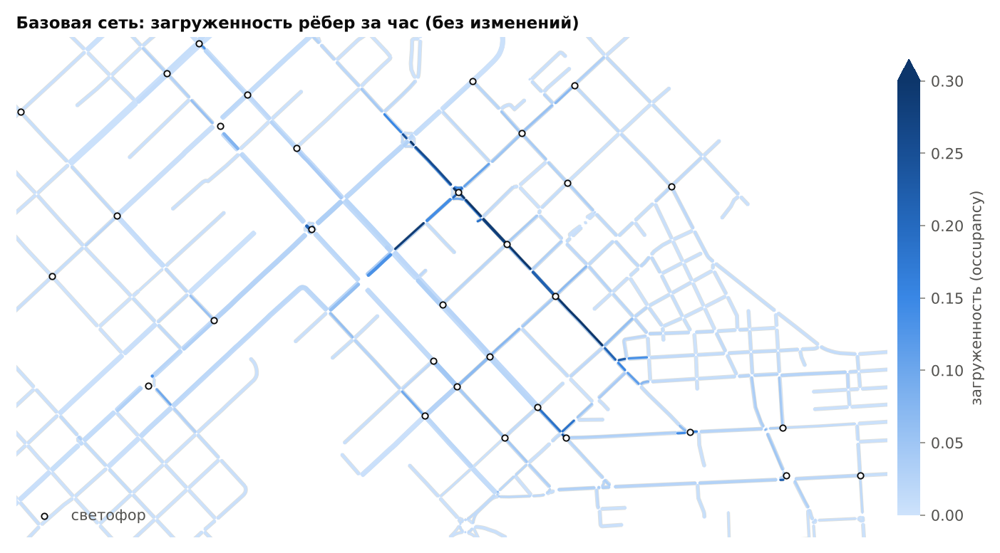
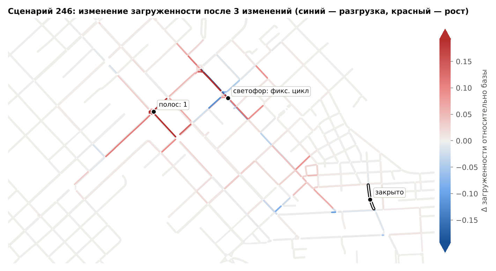

# sim/ — моделирование района в SUMO и генерация обучающих данных

Часть дипломного проекта «Проектирование архитектуры интеллектуальной системы
моделирования и оптимизации городской транспортной сети».

**Роль в архитектуре.** Микросимулятор SUMO работает только «офлайн» и
генерирует обучающие данные. Он прогоняет сотни и тысячи вариантов дорожной
сети района с изменениями (полосы, скорость, закрытие улиц, светофоры) и для
каждого варианта записывает загруженность, скорость и время проезда каждого
участка. На этих данных учится графовая нейросеть (`ml/`), которая в рабочем
режиме приложения заменяет SUMO и выдаёт прогноз за миллисекунды. Кроме того,
`sim/` отдаёт базовую сеть и спрос для RL-агентов светофоров (`agents/`) и граф
сети для карты (`backend/`, `frontend/`).

```
map.osm ──netconvert──► base.net.xml ──► network.json (граф по контракту)
                             │
               randomTrips ──┴──► trips.xml (1 ч спроса)
                             │
  случайные изменения ──► патч netconvert ──► сеть сценария ──► SUMO ──► edgeData
                                                                           │
                         edges.parquet / nodes.parquet / scenarios.parquet ◄┘ ──► отчёт
```

## Что сделано

1. **Сеть района** (`build_network.py`): `map.osm` → `netconvert` → `data/base.net.xml` →
   `data/network.json` по контракту. Если OSM-файла нет, строится синтетическая
   решётка 4×4 (`netgenerate`).
2. **Трафик** (`generate_traffic.py`): `randomTrips` формирует 1 час спроса
   (`data/trips.xml`), базовый прогон SUMO на 1 час модельного времени
   (`data/baseline/`), готовая конфигурация `data/base.sumocfg`.
3. **Генератор сценариев** (`scenarios.py`, `changes.py`): 1–5 случайных изменений по
   контракту → применение к сети → прогон SUMO → метрики каждого ребра через `edgeData`.
4. **Датасет** (`build_dataset.py`): параллельный прогон сценариев на всех ядрах,
   запись в Parquet. Сгенерирован пробный датасет: **300 сценариев + базовый**
   (`data/dataset/`).
5. **Отчёт** (`report.py`): `reports/report.md` с временем на сценарий,
   распределениями метрик и графиками; `reports/summary.json` с ключевыми числами.
6. **Шум симуляции** (`noise_floor.py`): разброс метрик при разных зёрнах SUMO —
   нижняя граница ошибки для нейросети.
7. **Тесты** (`tests/`): юнит-тесты контракта изменений и сквозной прогон на решётке 4×4.

## Быстрый старт

Python 3.11. Из корня репозитория:

```bash
python3.11 -m venv .venv && source .venv/bin/activate
pip install -r sim/requirements.txt
```

SUMO ставится из pip (`eclipse-sumo`), отдельная установка и `SUMO_HOME` не нужны:
путь берётся из пакета. Если `SUMO_HOME` задан, используется он.

Весь конвейер одной командой (≈20 мин на 4 ядрах для 300 сценариев):

```bash
bash sim/run_all.sh 300
```

Или по шагам:

```bash
python -m sim.build_network                    # 1. сеть (map.osm или решётка 4×4)
python -m sim.generate_traffic                 # 2. спрос + базовый прогон на 1 час
python -m sim.scenarios --seed 7               # 3. один случайный сценарий (проверка)
python -m sim.noise_floor --seeds 8            #    шум симуляции (для отчёта)
python -m sim.build_dataset --n-scenarios 300  # 4. датасет, все ядра
python -m sim.report                           # 5. отчёт в sim/reports/
python -m pytest sim/tests -q                  # тесты
```

Полезные варианты:

```bash
python -m sim.build_network --grid                         # принудительно решётка 4×4
python -m sim.generate_traffic --calibrate 4800,6000,7200  # подбор уровня спроса
python -m sim.build_dataset --n-scenarios 2000 --resume    # дорастить датасет без пересчёта готового
python -m sim.scenarios --changes '[{"type":"close","target_id":"-1077110576#0","value":null}]'
```

## Структура папки

| Файл | Назначение |
|---|---|
| `config.py` | все пути и числовые параметры моделирования в одном месте |
| `sumo_tools.py` | поиск SUMO (pip-пакет или `SUMO_HOME`), запуск утилит |
| `build_network.py` | шаг 1: OSM/netgenerate → `.net.xml` → `network.json` |
| `typemaps/urban.typ.xml` | классы дорог и городские скорости для импорта OSM |
| `generate_traffic.py` | шаг 2: randomTrips, `base.sumocfg`, базовый прогон, калибровка спроса |
| `simulate.py` | запуск SUMO с едиными опциями, разбор `edgeData` и статистики |
| `changes.py` | **контракт изменений**: проверка, применение к графу, компиляция в патчи netconvert (без зависимости от SUMO) |
| `scenarios.py` | шаг 3: генератор случайных изменений и прогон одного сценария |
| `build_dataset.py` | шаг 4: параллельная сборка датасета в Parquet |
| `noise_floor.py` | разброс метрик при разных зёрнах SUMO |
| `report.py` | шаг 5: отчёт и графики |
| `run_all.sh` | весь конвейер одной командой |
| `tests/` | `test_changes.py` (контракт), `test_pipeline_grid.py` (сквозной прогон) |
| `data/` | результаты (см. ниже) |
| `reports/` | отчёт `report.md`, `summary.json`, графики `fig_*.png` |

## Выходные данные

| Файл | Что внутри | Кто использует |
|---|---|---|
| `data/network.json` | граф района по контракту | ml/, backend/, frontend/ |
| `data/base.net.xml` | сеть SUMO | agents/ (`evaluate(network_path, ...)`) |
| `data/trips.xml` | 1 час поездок (6000 авт/ч) | agents/ |
| `data/base.sumocfg` | сеть + спрос + те же опции SUMO, что в датасете | agents/, sumo-gui |
| `data/baseline/edges.json`, `summary.json` | метрики базовой сети | ml/ (точка «до»), генератор сценариев |
| `data/dataset/*.parquet`, `meta.json` | датасет | ml/ |
| `data/dataset/seed_noise.parquet` | базовая сеть при 8 зёрнах SUMO | отчёт, ml/ (оценка предела точности) |

### network.json

```jsonc
{
  "meta":  {"source": "osm", "bbox": [...], "n_nodes": 318, "n_edges": 836, ...},
  "nodes": [{"id": "525499935", "lon": 69.14, "lat": 54.86, "type": "traffic_light",
             "tl_id": "525499935", "tl_type": "static"}],
  "edges": [{"id": "-1077110576#0", "from": "12166016825", "to": "3494782576",
             "length": 114.79, "lanes": 1, "speed": 16.67, "priority": 10,
             "geometry": [[69.1458606, 54.8739183], ...],
             "name": "Алтынсарин көшесі", "road_type": "highway.tertiary", "closed": false}]
}
```

Поля контракта: `nodes[id, lon, lat, type]`, `edges[id, from, to, length, lanes,
speed, priority, geometry]`. Единицы: `length` в метрах, `speed` в м/с (разрешённая
скорость), `geometry` — список `[lon, lat]` (порядок GeoJSON, EPSG:4326). Рёбра
направленные: у двусторонней улицы два ребра (`123#0` и `-123#0`). Геометрия
проходит по оси полос своего направления, поэтому на карте встречные
направления не накладываются друг на друга. `type` узла — тип перекрёстка SUMO:
`traffic_light`, `priority`, `right_before_left`, `dead_end`.

Дополнительные поля (вне контракта, их можно игнорировать): `tl_id` и `tl_type`
у узлов (`static` — фиксированный цикл, `actuated` — адаптивный), `name`,
`road_type`, `closed` у рёбер, блок `meta`.

### Изменения

| type | target_id | value |
|---|---|---|
| `lanes` | id ребра | новое число полос, целое 1..6 |
| `speed` | id ребра | новая разрешённая скорость, м/с (1..40) |
| `close` | id ребра | `null`: движение запрещено |
| `open` | id ребра | `null`: запрет снят |
| `traffic_light` | id узла | `"static"` / `"actuated"` / `"off"` (синонимы: `true`/`"on"` → `static`, `false`/`null`/`"none"` → `off`) |

Изменения применяются **по порядку**: `[close A, open A]` ничего не меняет, а `open`
снимает закрытие и с ребра, закрытого ещё во входной сети (`closed: true`).
Функция `sim.changes.apply_changes(network, changes)` возвращает итоговый граф, в
котором у изменённых элементов стоит `"changed": true`. Её можно импортировать
из `ml/` и `backend/` (`from sim.changes import apply_changes`). Модуль не зависит от SUMO,
поэтому нейросеть и симулятор понимают изменения одинаково. Неверное
изменение вызывает `ChangeError` с понятным сообщением: неизвестное ребро,
0 полос, светофор в тупике и т.п.

### Датасет (data/dataset/)

`edges.parquet` — строка на пару (сценарий, ребро), 836 рёбер × 301 сценарий:

| колонка | смысл |
|---|---|
| `scenario_id` | 0 — базовая сеть, 1..300 — сценарии с изменениями |
| `edge_id` | id ребра (как в `network.json`) |
| `lanes`, `speed_limit`, `closed`, `changed` | состояние ребра **после** изменений (признаки) |
| `occupancy` | **цель**: доля длины ребра, занятая машинами, 0..1, среднее за час |
| `mean_speed` | **цель**: средняя скорость машин, м/с |
| `travel_time` | **цель**: среднее время проезда ребра, с |
| `density`, `waiting_time`, `time_loss`, `entered`, `left`, `sampled_seconds` | доп. метрики edgeData |

`nodes.parquet` — строка на пару (сценарий, узел): `type`, `tl_type`, `changed`.
`scenarios.parquet` — строка на сценарий: `changes` (JSON-список по контракту),
число изменений каждого типа, сводка SUMO (вставлено машин, телепорты, средняя
длительность поездки и потери времени), сетевые агрегаты, время netconvert/SUMO,
`status`. `meta.json` — параметры генерации и описание колонок.

У закрытых рёбер `occupancy = 0`, а `mean_speed` и `travel_time` равны `NaN`: на
закрытом ребре нет машин, поэтому эти величины не определены. При обучении такие
строки маскируются по флагу `closed`. По ребру без машин SUMO записывает
значения свободного движения: скорость равна разрешённой, время = длина / скорость.

Пример чтения:

```python
import json, pandas as pd
edges = pd.read_parquet("sim/data/dataset/edges.parquet")
scen  = pd.read_parquet("sim/data/dataset/scenarios.parquet")
net   = json.load(open("sim/data/network.json"))
static = pd.DataFrame(net["edges"])[["id", "length", "priority"]].rename(columns={"id": "edge_id"})
X = edges.merge(static, on="edge_id")               # признаки + цели
changes_of_5 = json.loads(scen.set_index("scenario_id").changes[5])
```

## Как устроен конвейер

### 1. Сеть

`netconvert` импортирует `map.osm` с параметрами, обоснованными ниже. После
импорта сеть один раз перевыгружается (`netconvert -s base -o base`), затем
экспортируется в `network.json`: координаты UTM переводятся в lon/lat через
проекцию, записанную в самой сети (pyproj).

Карта: Петропавловск, выгрузка OSM ≈ 3,3 × 1,9 км. Получено 318 узлов, 836
направленных рёбер, 31 светофор, 108 км полос-направлений.

### 2. Спрос

`randomTrips.py` создаёт 6000 поездок за час (пуассоновский поток) между
перекрёстками (`--junction-taz`). Поездки чаще начинаются на границе района
(`--fringe-factor 5`, транзит) и на многополосных улицах (`--lanes`). Короче
300 м поездки не создаются. Все сценарии используют один и тот же файл спроса.

### 3. Сценарий

1. `changes.apply_changes` даёт итоговый граф;
2. `changes.diff_states` выделяет отличия от базы, `to_netconvert_patches`
   превращает их в файлы `*.edg.xml` / `*.nod.xml`;
3. `netconvert -s base.net.xml -e patch.edg.xml -n patch.nod.xml` собирает сеть
   сценария: пересчитывает связи полос на перекрёстках и программы затронутых
   светофоров;
4. SUMO 1 час модельного времени, `edgeData` за интервал 300–3600 с.

### 4. Датасет

`multiprocessing.Pool` на всех ядрах: один процесс считает один сценарий
целиком. Каждый сценарий сразу пишется в `parts/`, поэтому прерванную сборку
можно продолжить (`--resume`) или дорастить. В конце части склеиваются в три
Parquet-файла (сжатие zstd).

## Принятые решения и почему

1. **Только рёбра для легковых, свой файл типов дорог** (`typemaps/urban.typ.xml`).
   В нём перечислены лишь проезжие классы OSM (primary … residential), поэтому
   дворовые проезды, парковки и тротуары (≈1100 объектов `service`/`footway`) в
   модель не попадают. Сеть остаётся компактной, а граф для нейросети — без шума.
   Стандартный файл SUMO задаёт загородные скорости (secondary — 100 км/ч). Для
   города заданы 60 км/ч на магистралях (ограничение ПДД РК для населённых
   пунктов) и 40 км/ч на жилых улицах. Тег `maxspeed` из OSM имеет приоритет.
2. **Обрезка по границам выгрузки** (`--keep-edges.in-geo-boundary`). OSM отдаёт
   улицы целиком, даже если они уходят далеко за выбранный район. Остаются
   только рёбра, пересекающие выбранную область.
3. **Объединение сложных перекрёстков** (`--junctions.join`, `--tls.guess-signals`,
   `--tls.join`). Перекрёсток улиц с разделительной полосой в OSM состоит из
   нескольких узлов и светофоров. После объединения каждый перекрёсток — это один
   узел графа и один светофор. Это важно и для GNN (узел = перекрёсток), и для
   RL-агентов (агент = светофор).
4. **Крупнейшая связная компонента** (`--keep-edges.components 1`). Изолированные
   кусочки сети дали бы невыполнимые поездки.
5. **Перевыгрузка базовой сети.** Сеть сценария строит netconvert из базовой сети
   и патча. Базовая сеть заранее прошла ту же перевыгрузку и стала неподвижной
   точкой (проверено: повторная перевыгрузка не меняет файл). Поэтому все отличия
   сценария от базы вызваны только изменениями, а не служебными пересчётами.
6. **Изменения → итоговое состояние → патч.** Контракт описывает изменения
   *списком действий*. Чтобы `ml/` и `sim/` гарантированно понимали его
   одинаково, сначала вычисляется итоговое состояние сети (чистый Python), и в
   SUMO отправляется только разница с базой. Модель учится на итоговом
   состоянии рёбер: колонки `lanes`, `speed_limit`, `closed`.
7. **Закрытие = запрет движения, а не удаление ребра** (`disallow="all"`). Так
   улицу перекрывают в жизни: геометрия, нумерация рёбер и программы светофоров
   сохраняются, граф для GNN не меняет форму. В `network.json` ребро остаётся с
   флагом `closed`.
8. **Поездки между перекрёстками** (`fromJunction/toJunction` + `--junction-taz`).
   Если поездка задана ребром, его закрытие делает её невозможной. Перекрёсток же
   имеет несколько выездов, и SUMO выберет открытый. Объём спроса во всех
   сценариях одинаков, а измеряется перераспределение потока, а не потеря машин.
9. **Закрытие не должно разрывать сеть.** Генератор закрывает ребро, только если
   все рёбра, взаимно достижимые в базовой сети, остаются взаимно достижимыми.
   Проверка идёт по графу «ребро → ребро» с учётом реально разрешённых поворотов
   (networkx). Так можно закрыть около 70 % рёбер, остальные — единственный
   подъезд к тупикам.
10. **Динамическая маршрутизация** (`--device.rerouting.probability 1`, период 120 с).
    Каждая машина пересчитывает маршрут по текущим измеренным временам проезда.
    Без этого маршруты выбирались бы по свободному движению: расширение улицы не
    притягивало бы поток, и эффект изменений был бы занижен. Полное равновесное
    распределение (`duaIterate`) точнее, но требует 20–50 итераций полной
    симуляции, т.е. в десятки раз дороже на сценарий.
11. **Уровень спроса 6000 авт/ч выбран калибровкой** (`--calibrate`):

    | авт/ч | телепорты | ср. потери времени | p90 occupancy | время SUMO |
    |---|---|---|---|---|
    | 2400 | 0 | — | 0,011 | 4,5 с |
    | 4800 | 0 | 85 с | 0,025 | 9,4 с |
    | **6000** | **4** | **126 с** | **0,040** | **13 с** |
    | 7200 | 53 | 188 с | 0,092 | 19 с |
    | 9600 | 104 | 284 с | 0,179 | 34 с |
    | 12000 | 396 | 434 с | 0,322 | 80 с |

    При 6000 авт/ч сеть работает близко к пропускной способности: потери
    составляют около половины времени поездки, как в час пик. Изменения при этом
    заметно меняют загрузку, а заторов-«гридлоков» почти нет (4 телепорта на
    6000 машин). При меньшем спросе изменения почти ни на что не влияют, при
    большем результат определяют случайные заторы.
12. **Одно зерно SUMO во всех сценариях** (метод общих случайных чисел). Разница
    «сценарий − база» тогда содержит меньше стохастического шума. Сам шум
    измерен отдельно (`noise_floor.py`) и приведён в отчёте как нижняя граница
    ошибки нейросети.
13. **Прогрев 5 минут.** Сеть стартует пустой, поэтому первые 300 с в метрики не
    входят: они описывают установившийся режим.
14. **Выбор рёбер для изменений ∝ √(поток + 10).** Изменения на нагруженных улицах
    информативнее для обучения, но тихие улицы тоже встречаются, иначе модель не
    видела бы, что изменение на тихой улице почти ни на что не влияет.
15. **Параллелизм по сценариям, а не внутри SUMO.** Сама микросимуляция в SUMO
    по сути однопоточна (потоки ускоряют только маршрутизацию), а сценарии
    независимы друг от друга. Поэтому каждый процесс считает свой сценарий
    (`--threads 1`), и ускорение близко к числу ядер.
16. **Parquet + длинный формат.** Одна строка на пару (сценарий, ребро) легко
    фильтруется pandas/pyarrow, сжимается в разы лучше CSV и хранит типы.
    Статические признаки рёбер (длина, приоритет, геометрия) не дублируются:
    они в `network.json` и присоединяются по `edge_id`.

## Ограничения и допущения

* Спрос синтетический (randomTrips), без реальной матрицы корреспонденций, и
  постоянный в течение часа. Для прототипа этого достаточно: модель учится
  реакции сети на изменения при фиксированном спросе. С реальной матрицей
  (`od2trips`) меняется только шаг 2.
* Моделируются только легковые автомобили, без общественного транспорта и пешеходов.
* Программы новых светофоров строит netconvert по умолчанию (цикл 90 с).
  Оптимизация программ — задача `agents/`.
* `open` в случайных сценариях встречается только после `close` того же ребра,
  потому что в базовой сети закрытых рёбер нет. Генерация пар
  `close` → `open` проверяет, что изменения применяются по порядку.
* Метрики усреднены за час. Пиковые значения внутри часа в датасет не входят.
  При необходимости это `period` у `edgeData` в `simulate.py`.

## Результаты пробного датасета

Подробно: [reports/report.md](reports/report.md), ключевые числа — в
`reports/summary.json`, графики — `reports/fig_*.png`.

| Показатель | Значение |
|---|---|
| Сценариев | 300 + базовый, ошибок 0 |
| Строк `edges.parquet` | 251 636 (836 рёбер × 301), 4,2 МБ |
| Время одного сценария | 13,2 с в одном процессе (0,5 с netconvert + SUMO); 15 с при 4 параллельных |
| Сборка 301 сценария на 4 ядрах | 19 мин, ≈950 сценариев/ч, ускорение ×3,6 (эффективность 90 %) |
| occupancy: медиана / p90 / p99 / макс | 0,007 / 0,039 / 0,26 / 0,67 |
| mean_speed: медиана / p10–p90 | 9,6 м/с / 4,4–14,6 м/с |
| travel_time: медиана / p99 / макс | 11 с / 109 с / 1011 с |
| Шум симуляции (σ по зёрнам SUMO) | occupancy 0,002; скорость 0,37 м/с; время 1,5 с |
| Эффект сценария на потери времени в сети | медиана +0,9 %, 90 % сценариев в [−12 %; +12 %] |
| Доля рёбер, «почувствовавших» сценарий | медиана 4 %, p95 12 % |

Эффекты изменений правдоподобны и служат проверкой данных. Снижение скорости
увеличивает время проезда ребра (медиана +33 %), повышение — уменьшает (−14 %).
Новый светофор с фиксированным циклом добавляет задержку на подходах (+78 %),
перевод светофора в адаптивный режим её снижает (−33 %). Изменение одного
ребра заметно меняет загрузку в среднем ещё на ~30 рёбрах вокруг: эффект
нелокален, и это обосновывает выбор графовой нейросети.



