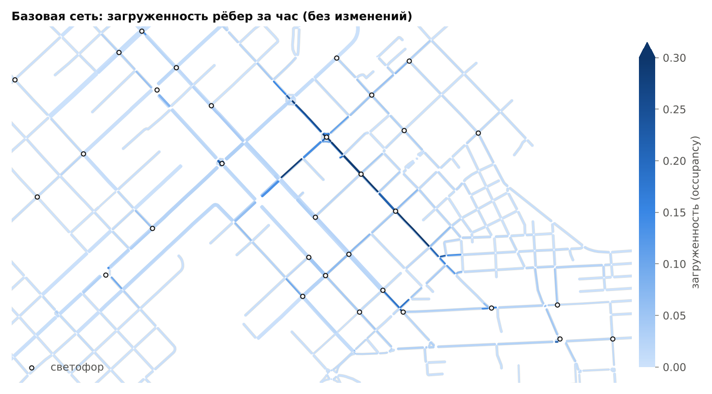
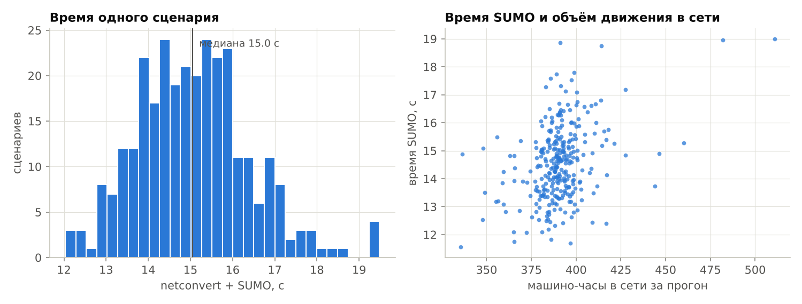
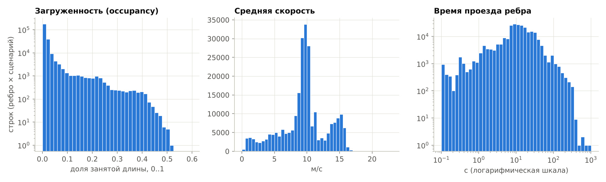
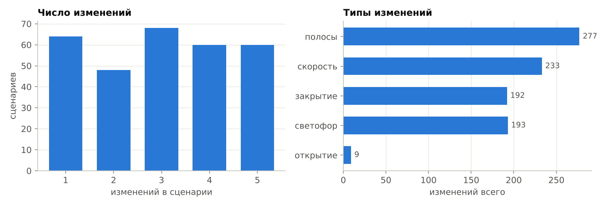
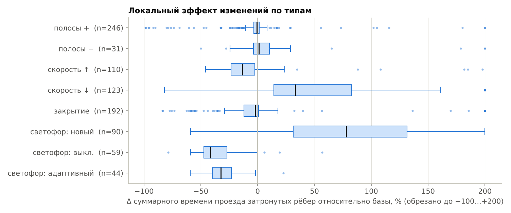
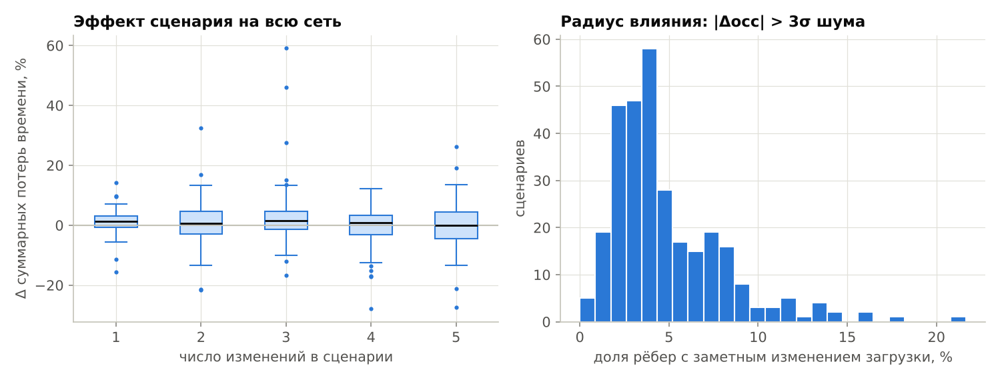
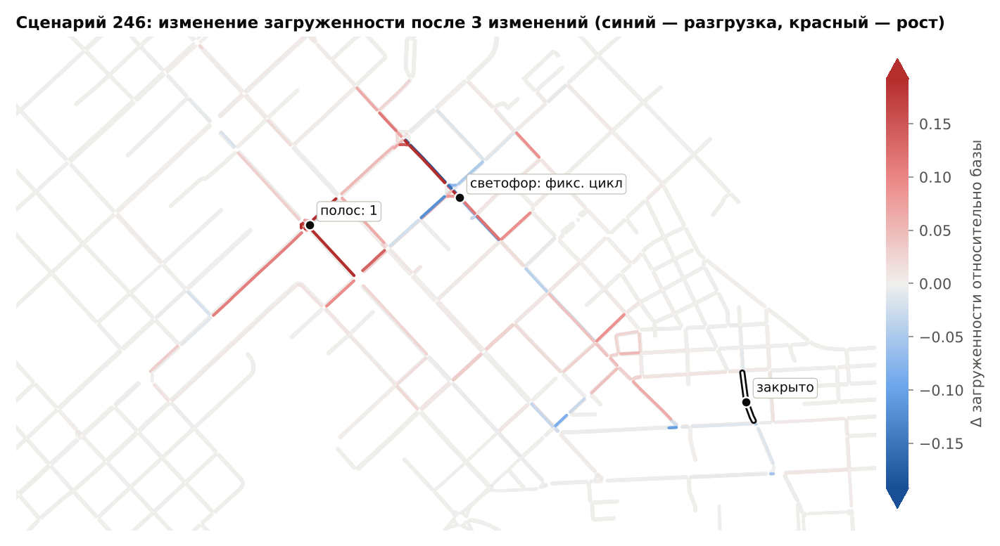

# Отчёт: генерация обучающих данных (sim/)

Сгенерировано `python -m sim.report` по датасету от 2026-11-04T07:47:28+00:00 (Eclipse SUMO sumo 1.28.0).

## 1. Что смоделировано

| Параметр | Значение |
|---|---|
| Источник сети | osm (`map.osm`), обрезка по границам выгрузки: да |
| Узлов / рёбер / светофоров | 318 / 836 / 31 |
| Протяжённость (все направления) | 108.26 км |
| Спрос | 6000 авт/ч, randomTrips, поездки между перекрёстками |
| Модельное время | 0–3600 с (1 ч), метрики по интервалу 300–3600 с |
| Сценариев | 301 (включая базовый №0), успешно 301, ошибок 0 |
| Строк в edges.parquet | 251 636 (836 рёбер × сценарии) |

Базовый прогон: загружено 6001 машин, въехало 5991, завершили поездку 5490, телепортов 4; средняя поездка 255 с, из них потери 126 с.

## 2. Время счёта

| Показатель | Значение |
|---|---|
| Время одного сценария в датасете (netconvert + SUMO, 4 процесса параллельно): медиана | 15.0 с |
| — среднее / p95 / максимум | 15.1 / 17.2 / 19.5 с |
| — из них netconvert / SUMO (в среднем) | 0.48 / 14.6 с |
| Базовый прогон SUMO: один процесс / при параллельной работе | 13.2 / 16.0 с |
| Параллельно: процессов | 4 |
| Общее время сборки | 19.0 мин на 301 сценариев |
| Производительность | 952 сценариев/ч |
| Ускорение от параллелизма | ×3.61 (эффективность 90 %) |

Время сценариев в датасете измерено при одновременной работе всех процессов, поэтому включает конкуренцию за память и кэш процессора: в одиночку тот же прогон идёт примерно в 1.11 раза быстрее. Ускорение посчитано честно — относительно последовательного счёта в одном процессе (время базового прогона в одиночку × число сценариев / общее время). Оценка: 10 000 сценариев на 4 ядрах ≈ 11 ч, на 32 ядрах ≈ 1.3 ч (при той же эффективности).

## 3. Распределения метрик рёбер

По всем открытым рёбрам всех сценариев (закрытые исключены: у них нет скорости и времени проезда).

| Метрика | мин | p25 | медиана | p75 | p90 | p99 | макс | среднее |
|---|---|---|---|---|---|---|---|---|
| occupancy, 0..1 | 0.000 | 0.003 | 0.007 | 0.017 | 0.039 | 0.263 | 0.673 | 0.021 |
| mean_speed, м/с | 0.100 | 8.120 | 9.620 | 11.110 | 14.570 | 15.820 | 19.770 | 9.469 |
| travel_time, с | 0.010 | 7.120 | 11.000 | 19.390 | 32.740 | 109.480 | 1011.260 | 16.582 |

Распределения сильно скошены: большинство рёбер — тихие жилые улицы с загрузкой около нуля, заторы сосредоточены на магистралях. Время проезда растянуто на несколько порядков (от долей секунды на коротких связках перекрёстков до минут в очередях), поэтому для обучения его разумно логарифмировать, а для occupancy — взвешивать тяжёлый «хвост».

## 4. Сценарии и влияние изменений

Медианы Δ времени проезда по категориям:

| Категория | n | медиана Δ, % | p10, % | p90, % |
|---|---|---|---|---|
| полосы + | 246 | -0.6 | -17.6 | +6.2 |
| полосы − | 31 | +1.0 | -22.7 | +65.1 |
| скорость ↑ | 110 | -13.5 | -32.3 | +5.3 |
| скорость ↓ | 123 | +33.2 | -8.3 | +113.2 |
| закрытие | 192 | -2.0 | -36.0 | +4.6 |
| светофор: новый | 90 | +77.9 | +20.0 | +159.2 |
| светофор: выкл. | 59 | -41.5 | -54.8 | -8.7 |
| светофор: адаптивный | 44 | -32.5 | -43.5 | -12.5 |

Для lanes/speed затронутым считается само ребро, для светофора — все въезды в перекрёсток, для закрытия — рёбра, ведущие к началу закрытого ребра. Знаки эффектов согласуются с физикой движения, это проверка правдоподобия данных: снижение скорости увеличивает время проезда, новый светофор с фиксированным циклом добавляет задержку на ранее нерегулируемом перекрёстке, адаптивное регулирование её снижает. Добавление полосы в среднем почти ничего не меняет: большинство рёбер не перегружено, и полоса помогает только на «узких местах» (длинный левый хвост распределения). Модели предстоит выучить именно такую зависимость эффекта от контекста.

Изменение суммарных потерь времени в сети относительно базы: медиана +0.9 %, 90 % сценариев в диапазоне [-12.0 %; +12.0 %]. Доля рёбер, у которых загрузка заметно (больше 3σ шума) изменилась: медиана 4 %, до 12 % (p95). Эффект изменения не локален — поток перераспределяется по соседним улицам; это аргумент в пользу графовой нейросети, которая учитывает соседей через передачу сообщений.

## 5. Шум симуляции (нижняя граница ошибки ML)

Базовая сеть прогнана с разными зёрнами SUMO (`python -m sim.noise_floor`). Средняя абсолютная разница между двумя такими прогонами — это точность, с которой симулятор согласуется сам с собой; предсказатель не может быть точнее.

| Метрика | средний по рёбрам σ | MAE между зёрнами |
|---|---|---|
| occupancy, 0..1 | 0.0021 | 0.0025 |
| mean_speed, м/с | 0.3670 | 0.4242 |
| travel_time, с | 1.4546 | 1.6568 |

Во всех сценариях датасета используется одно и то же зерно (метод общих случайных чисел), поэтому разница «сценарий − база» содержит меньше шума, чем разница двух независимых прогонов.

## 6. Качество данных

* Телепорты (SUMO убирает машину, простоявшую в заторе > 300 с): медиана 7, p95 20, макс 68 на сценарий (при ~6001 машинах).
* Машины, не успевшие въехать в сеть к концу часа: медиана 9, p95 17, макс 34.
* Сценариев с ошибкой: 0.
* Закрытые рёбра: occupancy = 0, mean_speed и travel_time = NaN — при обучении их нужно маскировать по флагу `closed`.
